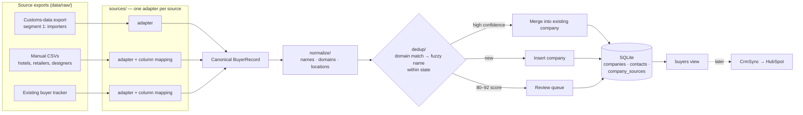

# Architecture

## The six stages

| # | Stage | Purpose | Status |
|---|---|---|---|
| 1 | Find buyers | Collect candidate buyers from many sources into one deduplicated table | 🚧 In progress |
| 2 | Enrich | Add firmographics, websites, verified contacts | Not started |
| 3 | Score | Rank buyers by fit and buying signals | Not started |
| 4 | Personalize | Draft outreach grounded in each buyer's signals (Claude API) | Not started |
| 5 | Review & send | Human approval, send, sync to HubSpot | Not started |
| 6 | Track & learn | Log outcomes and feed them back into scoring | Not started |

## Stage 1 data flow

## Module map (Stage 1, planned)

| Module | Responsibility | Built |
|---|---|---|
| `cli.py` | typer commands | ✅ skeleton (`version`, `info`) |
| `config.py` | Settings from `.env` | ✅ |
| `models.py` | `BuyerRecord`, the canonical record adapters emit | — |
| `sources/` | `SourceAdapter` protocol + one adapter per source | — |
| `normalize/` | Company names, domains, cities/states | — |
| `dedup/` | Candidate matching and merge logic | — |
| `storage/` | SQLite schema and repository | — |
| `pipeline.py` | Orchestrates one ingestion run, returns a summary | — |
| `sync/` | `CrmSync` interface only (HubSpot later) | — |

## Key decisions

- [[0001-sqlite-local-first]] — SQLite, local-first, real data never committed

Related: [[data-dictionary]], [[index]]
